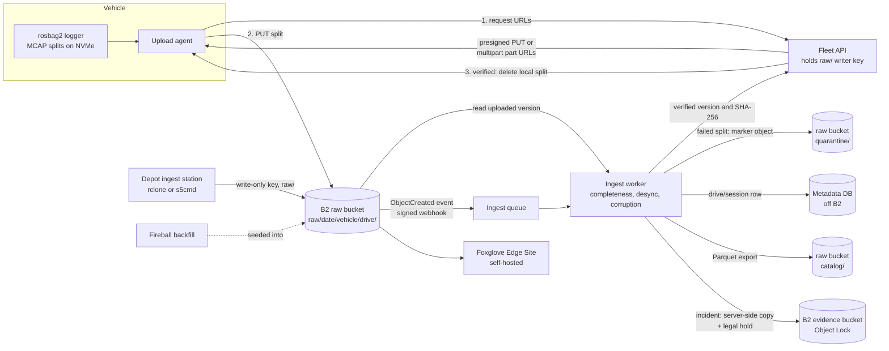
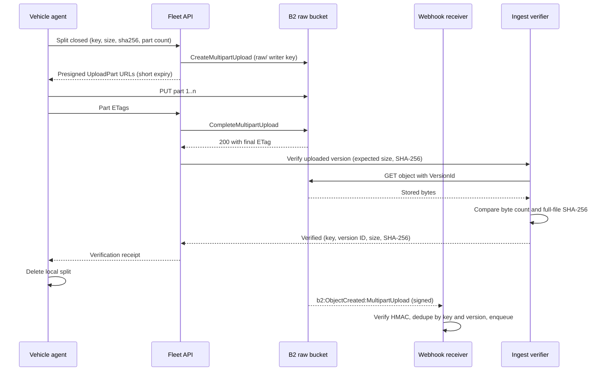

# Offload drive logs from vehicles and depots into a versioned raw zone

## Workload

A test fleet records synchronized camera, LiDAR, radar, IMU/GNSS, and CAN topics. Size the local buffer and depot uplink from measured recording rates, offline duration, and the offload window. The logger closes a [rosbag2](https://docs.ros.org/en/rolling/Tutorials/Beginner-CLI-Tools/Recording-And-Playing-Back-Data/Recording-And-Playing-Back-Data.html) split in [MCAP](https://mcap.dev/) format every N GB or N minutes.

Three paths move those splits into B2:

1. **Over the air (cellular):** only trigger-flagged event windows, such as disengagements, hard braking, and model-uncertainty triggers.
2. **Depot (Wi-Fi or wired):** full splits, uploaded by an ingest station or by the vehicle through presigned URLs.
3. **Shipped drives and historic backfills:** synced by depot ingest stations. Very large archives are seeded with [Backblaze Fireball](https://www.backblaze.com/cloud-storage/features/fireball-data-migration) units.

B2 is the system of record for the raw logs. Everything downstream (extraction, labeling, training, re-sim, audit) reads from this zone.

## Data flow

A single presigned PUT is limited to 5 GB, so splits larger than that use presigned multipart part URLs. The fleet API holds the key and starts and completes the multipart upload. The vehicle only ever sees URLs. A lifecycle rule cancels multipart uploads that never complete (B2 pattern).

The upload response records completion and the object version ID. Before acknowledging deletion, the ingest verifier reads that exact version, computes its full-file SHA-256, and compares the digest and byte count with the closed split reported by the vehicle. The vehicle retains the split until it receives the verification receipt. A `HeadObject` size check or multipart ETag alone does not establish this full-file match. The signed `ObjectCreated` event independently reconciles the expected split list. The fleet API retains a `writeFiles` key; the verifier holds the separate read credential.

## B2 zones

| Zone | Bucket and prefix | Versioning and lifecycle | Object Lock | Purpose |
|---|---|---|---|---|
| Raw | `<org>-av-raw/raw/<date>/<vehicle>/<drive_id>/` | Keep all versions; cancel unfinished multipart uploads after N days ([lifecycle-raw.json](../../examples/lifecycle-raw.json)) | Default governance retention where the program requires immutability | Versioned drive-log splits; failed splits stay here and are flagged in the metadata DB |
| Quarantine | `<org>-av-raw/quarantine/<drive_id>/` | Hide after the investigation window, then delete | No | Small JSON markers (split key, version ID, failure reason) for splits that fail completeness or corruption checks |
| Catalog export | `<org>-av-raw/catalog/drives/` | Overwrite per export; prior versions expire | No | Parquet copy of the drive/session table for lake queries |
| Evidence | `<org>-av-evidence/incidents/<incident_id>/` | Never expire while locked | Governance by default, plus legal hold per incident ([object-lock-evidence.json](../../examples/object-lock-evidence.json)) | Incident and disengagement splits for the safety case |

The raw zone is versioned, not immutable by default. Keys with `writeFiles` can upload a new version over a split or hide it; the prior version stays recoverable because no runtime key has `deleteFiles`. Where the program needs immutability, set default governance retention on the raw bucket (the bucket must have Object Lock enabled) so versions cannot be deleted before the period ends.

Failed splits are not copied. A server-side copy from `raw/` to `quarantine/` needs one key that reads `raw/` and writes `quarantine/`, but a key holds at most one name prefix, so it would require a bucket-wide `listFiles,readFiles,writeFiles` key in the ingest worker. Instead the worker records the quarantine status in the metadata database and writes a marker object under `quarantine/` with its write-only key. Use the bucket-wide key only if a downstream tool needs the bytes physically moved.

Use separate buckets for raw and evidence because Object Lock, default retention, and notifications are set per bucket. Bucket names are globally unique, so expect collisions and keep the `<org>-` prefix.

## Boundaries

| Stays off B2 | Where it lives | Why |
|---|---|---|
| Live vehicle telemetry | Streaming platform (MQTT, Kafka) | Low-latency, small-message traffic |
| On-vehicle split buffer | Vehicle NVMe | Logger writes locally; upload is asynchronous |
| Fleet API that issues presigned URLs | Application servers | Holds the only key that can write raw/ on behalf of vehicles |
| Ingest queue and workers | Queue service and compute | Event Notifications are at-least-once and need idempotent processing |
| Authoritative drive/session metadata | Transactional database | B2 holds an exported Parquet copy, not the source of truth |
| Foxglove index state | Foxglove Edge Site and its control plane | The vendor's own index; B2 holds only the recordings |

## B2 capability map

| Capability | Used | How |
|---|---|---|
| S3-compatible API | Yes | Uploads, version-specific checksum verification, server-side copy to evidence |
| Presigned URLs | Yes | PUT and UploadPart for vehicles; no keys on vehicles |
| CORS | No | No browser access in this flow |
| Multipart upload | Yes | Splits over 5 GB; rclone and s5cmd use multipart automatically |
| Scoped application keys | Yes | Fleet API writer, per-depot write-only key, ingest worker, evidence publisher |
| Event Notifications | Yes | `raw/` ObjectCreated to the ingest webhook ([event-notifications.json](../../examples/event-notifications.json)) |
| Object versions | Yes | Overwrites and hides keep the prior version recoverable |
| Lifecycle rules | Yes | Cancel unfinished multipart uploads; expire quarantine |
| SSE-B2 | Yes | Default bucket encryption ([sse.json](../../examples/sse.json)) |
| Object Lock and legal hold | Yes | Evidence bucket; optional default retention on the raw bucket |
| Cloud Replication | No | Not needed for ingest. If you need a second region for DR, replication is bucket-to-bucket and not a delivery path |
| Fireball | Yes | Seeding historic backfills |
| Included egress, CDN, compute partners | No | Ingest is write-heavy |
| Standard B2 vs Overdrive vs local cache | Standard | Depot uplink bandwidth usually limits ingest. Consider [Overdrive](https://www.backblaze.com/cloud-storage/b2-overdrive) only if a measured sustained aggregate write rate exceeds what Standard delivers |

## Configure the integrations

Derive the endpoint from the bucket's region: `https://s3.<region>.backblazeb2.com`. Never copy a region from an example.

### rclone (depot ingest stations)

- Connection: rclone's native [B2 backend](https://rclone.org/b2/) is documented by [Backblaze](https://www.backblaze.com/docs/cloud-storage-integrate-rclone-with-backblaze-b2). The S3 backend with the B2 endpoint also works.
- Key: one per depot, scoped to `<org>-av-raw` and `raw/`, with `listFiles,writeFiles`. Omit `readFiles` and `deleteFiles`. If you run `rclone check` or `--checksum` comparisons, add `readFiles` only for that verification step.
- Keep the key in rclone's config file with mode `0600`, or in environment variables. Never put it on the command line.
- Use `rclone copy`, not `sync --delete`. Depots only add splits; deletion and cleanup belong to lifecycle rules.

### s5cmd (high-parallelism depot ingest)

- Connection: `--endpoint-url https://s3.<region>.backblazeb2.com`, or `S3_ENDPOINT_URL` ([README](https://github.com/peak/s5cmd#readme)).
- Key: the same depot-scoped write-only key.
- Throughput: size `--numworkers`, `cp --concurrency`, and `cp --part-size` to the depot uplink; multi-GB splits upload as multipart.

### Foxglove Edge Site (self-hosted)

- Connection: in the Helm values, set `recordingStorage.provider=s3_compatible`, set `recordingStorage.s3CompatibleServiceUrl` to the B2 endpoint and `recordingStorage.s3CompatibleServiceRegion` to the bucket region, and put the B2 key pair in the `recording-storage-credentials` secret ([installation guide](https://docs.foxglove.dev/docs/data/edge-sites/installation)).
- Key: read-only, scoped to `raw/`, unless the Edge Site must write. Check the vendor guide for the capabilities it needs.
- Use the self-hosted Edge Site for B2. Foxglove's managed [bring-your-own-storage setup](https://docs.foxglove.dev/docs/data/primary-sites/foxglove-managed-setup) takes AWS, GCP, or Azure buckets. Include the index metadata an Edge Site sends to Foxglove's hosted control plane in your data-residency review.

### Vehicle presigned uploads (B2 pattern)

The [Rosbag2 Cloud Offload](https://github.com/backblaze-b2-samples/rosbag2-cloud-offload) sample demonstrates presigned-PUT offload and session cataloging. The fleet workflow above separates signing from version-specific checksum verification and adds multipart part URLs, retries, and backpressure.

## Security

- **Scoped keys per role:** fleet API (`writeFiles` on `raw/`), depot (`listFiles,writeFiles` on `raw/`), ingest worker and checksum verifier (`listFiles,readFiles` on `raw/`, plus separate `writeFiles` keys for `quarantine/` markers and `catalog/`), evidence publisher (reads the raw bucket and writes the evidence bucket with `writeFileRetentions,writeFileLegalHolds`; a cross-bucket server-side copy needs one key that covers both buckets). A key has at most one name prefix, so a worker that writes two prefixes needs two keys. See [examples/README.md](../../examples/README.md#scoped-application-keys).
- Bucket, lifecycle, notification, and Object Lock setup need an admin or master key. Run that setup once from provisioning and keep the key out of runtime services.
- Presigned URLs are bearer credentials. Keep expiry to minutes, sign one object key per URL, and never log the URLs.
- Webhooks: verify `X-Bz-Event-Notification-Signature` (HMAC-SHA256), acknowledge quickly, and dedupe on object key and version, because delivery is at-least-once ([reference](https://www.backblaze.com/docs/cloud-storage-event-notifications-reference-guide)). The [B2 Event Broker](https://github.com/backblaze-b2-samples/b2-event-broker) sample shows signature verification and fan-out.
- Raw camera data contains faces and license plates. Restrict `raw/` readers to extraction and anonymization jobs.
- Governance-mode retention can be bypassed by a key with `bypassGovernance`. Compliance mode cannot be shortened, and enabling Object Lock on a bucket is one-way. Choose compliance mode only for a documented requirement.

## Related samples

- [Rosbag2 Cloud Offload](https://github.com/backblaze-b2-samples/rosbag2-cloud-offload): presigned-PUT split offload and a Parquet session catalog.
- [Roboflow Inference Frame Archive](https://github.com/backblaze-b2-samples/roboflow-inference-frame-archive): archives only flagged frames, similar to trigger-based upload.
- [B2 Event Broker](https://github.com/backblaze-b2-samples/b2-event-broker) and [b2listen](https://github.com/backblaze-b2-samples/b2listen): event verification and fan-out, and local development forwarding.

## References

- [Backblaze S3-compatible API](https://www.backblaze.com/docs/cloud-storage-s3-compatible-api)
- [B2 application keys](https://www.backblaze.com/docs/cloud-storage-application-keys)
- [B2 Event Notifications reference](https://www.backblaze.com/docs/cloud-storage-event-notifications-reference-guide)
- [B2 lifecycle rules](https://www.backblaze.com/docs/cloud-storage-lifecycle-rules)
- [B2 Object Lock](https://www.backblaze.com/docs/cloud-storage-object-lock)
- [B2 large files (multipart)](https://www.backblaze.com/docs/cloud-storage-large-files)
- [B2 pricing](https://www.backblaze.com/cloud-storage/pricing)
