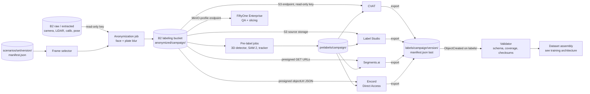
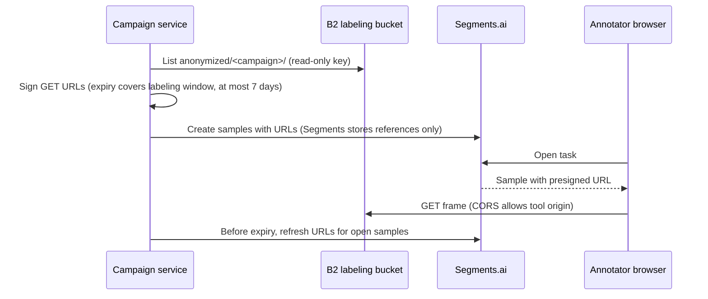

# Anonymize, pre-label, and annotate camera and LiDAR frames, then publish versioned label sets

## Workload

A labeling campaign starts from a frozen scenario set produced by [scenario mining](../sensor-lake-scenario-mining/architecture.md). It covers tens of thousands to millions of synchronized LiDAR sweeps and surround-camera frames, together with calibration and ego-pose. Before anyone outside the core team sees a frame, faces and license plates are blurred. Models then pre-label the frames (3D boxes, SAM 2 masks, tracks), and humans refine the results in a labeling tool. Each campaign's output is a versioned label set tied to the scenario-set version it came from.

B2 keeps one copy of the media and gives each tool scoped access to it. Annotation tool state stays in each tool's own database.

## Data flow

## B2 zones

| Zone | Bucket and prefix | Versioning and lifecycle | Object Lock | Purpose |
|---|---|---|---|---|
| Source (input) | `<org>-av-raw/raw/` and `<org>-av-lake/extracted/` | See upstream architectures | — | Never exposed to labeling tools |
| Anonymized | `<org>-av-label/anonymized/<campaign>/` | Hide after the campaign plus the review window | No | Blurred camera frames plus LiDAR, calibration, and pose |
| Pre-labels | `<org>-av-label/prelabels/<campaign>/<model>/` | Expire after the campaign | No | Model outputs loaded into tools |
| Labels | `<org>-av-label/labels/<campaign>/<version>/` | Immutable versions; keep | Optional governance retention for releases that feed safety-relevant models | KITTI, nuScenes, or COCO JSON exports, with `manifest.json` written last |

Event Notifications filter by object-name prefix, not suffix. The rule on `labels/` fires for every exported file, so the validator must ignore everything except `manifest.json`.

## Boundaries

| Stays off B2 | Where it lives | Why |
|---|---|---|
| CVAT, Label Studio, and FiftyOne databases, queues, and caches | Block storage next to each tool | Transactional application state |
| Vendor workforce systems | The vendor (Segments.ai) | Holds only URL references to B2 objects |
| GPU compute for anonymization and pre-labeling | GPU nodes or a compute partner | Batch jobs read from and write to B2 |
| Taxonomy and campaign tracking | Campaign service database | Small, mutable state |

## B2 capability map

| Capability | Used | How |
|---|---|---|
| S3-compatible API | Yes | CVAT, Label Studio, and FiftyOne Enterprise connect through a custom endpoint |
| Presigned URLs | Yes | Segments.ai samples, and Label Studio when presigned mode is on. Maximum expiry is 7 days |
| CORS | Yes | Exact-origin GET/HEAD for browser-loaded media ([cors-labeling.json](../../examples/cors-labeling.json)) |
| Multipart upload | Yes | Large point-cloud and export uploads (client-managed) |
| Scoped application keys | Yes | Tool readers on `anonymized/`; separate writers for `labels/` |
| Event Notifications | Yes | `labels/` ObjectCreated starts validation |
| Object versions | Yes | Protect label exports from overwrite |
| Lifecycle rules | Yes | Expire anonymized and pre-label working copies after a campaign |
| SSE-B2 | Yes | Default encryption |
| SSE-C | No | Browser tools and presigned URLs cannot supply customer-key headers |
| Object Lock | Optional | Label releases that feed safety-relevant models |
| Cloud Replication | No | Not part of this flow |
| Included egress, CDN, compute partners | Partly | Annotator reads are B2 egress; check [pricing](https://www.backblaze.com/cloud-storage/pricing) |
| Standard B2 vs Overdrive vs local cache | Standard | Annotator latency depends on the tool and browser path, not on Overdrive |

## Configure the integrations

Derive `https://s3.<region>.backblazeb2.com` from the labeling bucket's region.

### CVAT

- Attach cloud storage with the **AWS S3** provider. Set the **Endpoint URL** to the B2 endpoint, then enter the bucket and a key pair, as in the [CVAT docs](https://docs.cvat.ai/docs/workspace/attach-cloud-storage/), whose Backblaze B2 section marks the Endpoint URL as required for B2, and the [Backblaze CVAT guide](https://www.backblaze.com/docs/cloud-storage-connect-backblaze-b2-cloud-storage-to-cvat).
- Key: `listBuckets,listFiles,readFiles` (`listBuckets` permits the CVAT `HeadBucket` check), scoped to `<org>-av-label` and `anonymized/`. Import pre-labels through CVAT's annotation import, and write exports with a separate `labels/` writer.
- CVAT rejects endpoints that resolve to private IP ranges, so self-hosted CVAT needs to reach the public B2 endpoint.

### Label Studio

- Add **Amazon S3** source storage. Set the optional **S3 Endpoint** to B2, set the bucket prefix to `anonymized/<campaign>/`, and use a read-only key. Add a separate target storage on `labels/<campaign>/` with a `listFiles,readFiles,writeFiles` key ([Label Studio S3 storage](https://labelstud.io/guide/storage_s3)).
- With presigned URLs on, annotator browsers fetch from B2 directly and need CORS. With them off, Label Studio proxies the media and no CORS rule is needed.

### Segments.ai

- Use **customer-secured URLs**. Your service signs GET URLs with a read-only `anonymized/` key and registers them as sample attributes. Segments stores only the URL references ([import data](https://docs.segments.ai/how-to-integrate/import-data)).
- SigV4 presigned URLs expire after at most 7 days. Either size campaigns to fit, or refresh the URLs for open samples before they expire.
- Segments.ai's cross-account cloud integration is AWS-specific; use customer-secured URLs for B2. Add the Segments.ai web app origin to the bucket CORS rule.

### Encord

- Use a **Direct Access** integration. Your service signs GET URLs with a read-only `anonymized/` key, writes them as `objectUrl` values in the registration JSON, and registers the files through the UI or SDK ([Direct Access integration](https://docs.encord.com/platform-documentation/General/annotate-data-integrations/annotate-direct-access-integration)). Add a CORS rule for the Encord app origin.
- With strict client-only access, include per-file metadata in the JSON; Encord then does not store the files on its servers.
- Re-sign URLs before the SigV4 7-day maximum for campaigns that run longer.
- Alternative: Encord's S3-compatible [MinIO integration](https://docs.encord.com/platform-documentation/General/annotate-data-integrations/annotate-minIO-integration) takes an access key pair, and its SDK addresses S3-compatible storage as `https://<endpoint>/<bucket>/<path>`. Use it with a read-only `anonymized/` key when your policy lets Encord hold a key and sign URLs itself.

### FiftyOne Enterprise

- Configure a MinIO credentials profile: `MINIO_ENDPOINT_URL` set to the B2 endpoint, or an ini file with `endpoint_url`, plus the key pair and region ([installation](https://docs.voxel51.com/enterprise/installation.html)). Media paths then use that endpoint as their prefix.
- Use a read-only key for QA. Write saved views or tags to FiftyOne's own database, not to B2.
- Open-source FiftyOne loads media from local paths. Sync the campaign slice to local disk with rclone before loading it there.

## Security

- **No raw access for labeling tools.** Labeling tool keys are scoped to `anonymized/` (plus `prelabels/` with a second key if a tool reads pre-labels directly). They never cover `raw/` or `extracted/`. See [examples/README.md](../../examples/README.md#scoped-application-keys).
- Export writers can write only `labels/<campaign>/`. The validator gets read-only access to `labels/`.
- CORS lists exact HTTPS origins and allows only `s3_get` and `s3_head`. Never use `*` on a bucket that holds people's images.
- Presigned URLs given to an external vendor are bearer credentials. Keep their expiry to the labeling window, and rotate the signing key to revoke all outstanding URLs if necessary.
- Restrict who can add storage connections in each tool, because the endpoint and key determine what the tool's server can read.

## Compliance

- Anonymize before external access. Record the anonymization model, version, and thresholds in the label release manifest.
- Keep un-blurred frames inside `raw/` and `extracted/`, with access limited to the extraction and anonymization roles.
- Align vendor data-processing agreements with where frames are served from (the B2 bucket region) and with what the vendor retains (URL references and labels).

## References

- [B2 CORS rules](https://www.backblaze.com/docs/cloud-storage-cross-origin-resource-sharing-rules)
- [B2 application keys](https://www.backblaze.com/docs/cloud-storage-application-keys)
- [B2 Event Notifications reference](https://www.backblaze.com/docs/cloud-storage-event-notifications-reference-guide)
- [B2 server-side encryption](https://www.backblaze.com/docs/cloud-storage-server-side-encryption)
- [B2 pricing](https://www.backblaze.com/cloud-storage/pricing)
