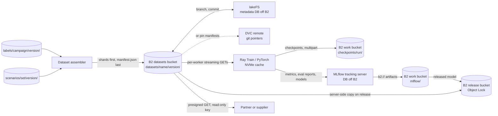

# Version perception datasets, stream them to training, and track checkpoints

## Workload

Perception teams assemble labeled scenarios into datasets for 3D detection, segmentation, tracking, and occupancy. A dataset ranges from tens of terabytes to petabytes and changes with every labeling campaign. Teams need to:

- reproduce any model from the exact drives, labels, anonymization version, and splits it was trained on;
- stream shards to multi-node GPU training without staging full copies on each node;
- persist checkpoints durably during long runs and keep released models and datasets for audit.

B2 holds the dataset versions, checkpoints, and run artifacts. lakeFS or DVC pins the versions, Ray Train streams and checkpoints, and MLflow tracks the runs.

## Data flow

A version is complete only when its `manifest.json` exists. The manifest lists every shard with its size and SHA-256, the source scenario-set and label versions, the anonymization version, and the split definitions. Consumers ignore a version directory that has no manifest.

## B2 zones

| Zone | Bucket and prefix | Versioning and lifecycle | Object Lock | Purpose |
|---|---|---|---|---|
| Datasets | `<org>-av-datasets/datasets/<name>/<version>/` | Immutable versions; keep | No (the release copy is locked) | WebDataset or Parquet shards plus the manifest |
| lakeFS storage namespace | `<org>-av-datasets/lakefs/<repo>/` | lakeFS garbage collection deletes; a hidden-only B2 rule reclaims what it deleted ([lifecycle-datasets.json](../../examples/lifecycle-datasets.json)) | No | lakeFS-managed objects |
| Checkpoints | `<org>-av-train/checkpoints/<run>/` | Hide after N days, then delete ([lifecycle-train-sim.json](../../examples/lifecycle-train-sim.json)). Size N above the longest expected run plus its resume window | No | Intermediate checkpoints |
| MLflow artifacts | `<org>-av-train/mlflow/` | Keep; prune by run policy | No | Metrics files, evaluation reports, registered models |
| Release | `<org>-av-release/datasets/…`, `<org>-av-release/models/…` | Never expire while locked | Governance default ([object-lock-evidence.json](../../examples/object-lock-evidence.json)) | Released dataset and model versions for lineage audits |

Copy a checkpoint to the release bucket before the lifecycle rule on `checkpoints/` hides it. Lifecycle applies to the whole prefix and cannot tell which checkpoints were promoted, or which run is still active: a hidden file is not listed, so Ray cannot resume from it. Size `daysFromUploadingToHiding` above the longest expected run plus pause and resume time, or write active runs under a separate prefix (for example `active/<run>/`) with no hide rule and move finished runs under `checkpoints/`.

Never set `daysFromUploadingToHiding` on `lakefs/`. lakeFS garbage collection deletes objects with `DeleteObject` and no version ID, which on B2 only hides them, so the hidden-only rule is what reclaims the storage ([why](../../examples/README.md#why-warehouse-and-lakefs-get-hidden-only-rules)).

## Boundaries

| Stays off B2 | Where it lives | Why |
|---|---|---|
| lakeFS metadata | PostgreSQL or DynamoDB-compatible KV, per lakeFS docs | Transactional commit graph |
| MLflow tracking data | MLflow backend database | Runs, params, and metrics are small and mutable |
| Shard cache and dataloader scratch | Local NVMe on GPU nodes | Repeated epochs re-read hot shards |
| Orchestration | Ray head, Kubernetes | Control plane |

## B2 capability map

| Capability | Used | How |
|---|---|---|
| S3-compatible API | Yes | Ray, MLflow (S3 mode), lakeFS, and DVC all use a custom endpoint |
| Presigned URLs | Yes | Dataset delivery to partners from a read-only key scoped to one version |
| CORS | No | No browser access |
| Multipart upload | Yes | Multi-GB checkpoints and shards (client-managed) |
| Scoped application keys | Yes | Training reader on `datasets/`; checkpoint writer; MLflow writer; release publisher |
| Event Notifications | Optional | Start dataset validation when `manifest.json` lands |
| Object versions | Yes | Overwrite protection for manifests |
| Lifecycle rules | Yes | Expire intermediate checkpoints; reclaim objects lakeFS GC deleted |
| SSE-B2 | Yes | Default encryption |
| Object Lock | Yes | Release bucket |
| Server-side copy | Yes | Promote dataset versions and models into the release bucket without re-uploading |
| Cloud Replication | No | Add only for a DR requirement; it is bucket-to-bucket, not delivery |
| Included egress, CDN, compute partners | Yes | Training on GPU clouds reads B2 directly; check [pricing](https://www.backblaze.com/cloud-storage/pricing) for current egress terms |
| Standard B2 vs Overdrive vs local cache | Standard plus NVMe cache by default | Measure GPU utilization first. Consider [Overdrive](https://www.backblaze.com/cloud-storage/b2-overdrive) when sustained multi-node read throughput is the proven bottleneck |

## Configure the integrations

Derive `https://s3.<region>.backblazeb2.com` from each bucket's region.

### Ray (Train)

- Set `RunConfig(storage_path="s3://<org>-av-train/checkpoints?endpoint_override=https://s3.<region>.backblazeb2.com")`, or set `AWS_ENDPOINT_URL_S3` with a plain `s3://` path. The [Ray persistent-storage guide](https://docs.ray.io/en/latest/train/user-guides/persistent-storage.html) gives this form with a Backblaze B2 example.
- Keys: the checkpoint writer key covers `checkpoints/` with `listFiles,readFiles,writeFiles,deleteFiles`. Ray reads checkpoints back to resume, and `num_to_keep` deletes old ones. The dataset reader key is a separate read-only key on `datasets/`.
- Streaming: split shards per worker and per node, as in the [WebDataset Streaming PyTorch Training](https://github.com/backblaze-b2-samples/webdataset-streaming-pytorch-training) sample.

### MLflow

- Native `b2://` artifact repository (`B2ArtifactRepository` is registered in MLflow's artifact-repository registry), or an `s3://` artifact root with `MLFLOW_S3_ENDPOINT_URL` set to the B2 endpoint ([Backblaze MLflow guide](https://www.backblaze.com/docs/cloud-storage-connect-backblaze-b2-to-mlflow), [artifact stores](https://mlflow.org/docs/latest/self-hosting/architecture/artifact-store/)).
- Key: scoped to `mlflow/`. Prefer proxied artifact access (`--artifacts-destination`), so that only the tracking server holds the key and clients do not.

### lakeFS

- Set `blockstore.type: s3`, `blockstore.s3.endpoint` to the B2 endpoint, `blockstore.s3.force_path_style: true`, and the region and credentials ([lakeFS configuration](https://docs.lakefs.io/reference/configuration/), [Backblaze lakeFS guide](https://www.backblaze.com/docs/cloud-storage-lakefs-integration-with-backblaze-b2)).
- Key: scoped to the lakeFS storage namespace prefix. lakeFS garbage collection needs delete permission on that prefix.
- The [lakeFS on B2 Quickstart](https://github.com/backblaze-b2-samples/lakefs-on-b2-quickstart) sample shows branch, commit, and merge.

### DVC

- Run `dvc remote add` with an `s3://` URL, then `dvc remote modify <name> endpointurl https://s3.<region>.backblazeb2.com` ([DVC S3 remote](https://doc.dvc.org/user-guide/data-management/remote-storage/amazon-s3)). Store credentials with `--local` so they stay out of git.
- DVC suits manifest-sized pointers and moderate datasets. lakeFS fits petabyte datasets that need branch semantics.

## Security

- Training clusters hold a read-only `datasets/` key and a `checkpoints/` writer key. They never hold release-bucket or Object Lock credentials. See [examples/README.md](../../examples/README.md#scoped-application-keys).
- The release publisher key runs only in the release pipeline. Promotion is a server-side copy, so the key covers both the source (`<org>-av-datasets` or `<org>-av-train`) and `<org>-av-release` buckets with `listFiles,readFiles,writeFiles,writeFileRetentions` (plus `writeFileLegalHolds` where used). See [examples/README.md](../../examples/README.md#scoped-application-keys).
- Partner delivery uses presigned GETs signed by a short-duration, read-only key scoped to `datasets/<name>/<version>/`. URL lists are secrets. Do not use Cloud Replication for delivery.
- Never put keys in `RunConfig` strings that get logged. Pass them through the environment or a secret store.

## References

- [Backblaze S3-compatible API](https://www.backblaze.com/docs/cloud-storage-s3-compatible-api)
- [B2 application keys](https://www.backblaze.com/docs/cloud-storage-application-keys)
- [B2 Object Lock](https://www.backblaze.com/docs/cloud-storage-object-lock)
- [B2 lifecycle rules](https://www.backblaze.com/docs/cloud-storage-lifecycle-rules)
- [S3 CopyObject on B2](https://www.backblaze.com/apidocs/s3-copy-object)
- [B2 pricing](https://www.backblaze.com/cloud-storage/pricing)
