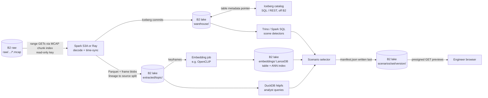

# Decode drive logs into a queryable sensor lake and mine long-tail scenarios

## Workload

Raw MCAP splits from the [drive-log offload](../drive-log-offload-ingest/architecture.md) zone are not searchable. Perception and validation teams need to:

- run SQL over billions of frame, object, and event rows (ego speed, detections, CAN signals, weather tags);
- run semantic search over camera keyframes for long-tail scenarios, such as cut-ins, pedestrians at night, or construction zones;
- freeze the results as versioned scenario sets that labeling, training, and re-sim can consume.

B2 holds the extracted tables, frame blobs, embeddings, and scenario manifests next to the raw logs. Query engines read them in place, so nothing is copied into a warehouse and no cluster has to run permanently.

## Data flow

Each scenario manifest lists pointers, not copies: source object key, version ID, time range, and topics. Labeling, training, and re-sim resolve the pointers to the raw or extracted objects.

## B2 zones

| Zone | Bucket and prefix | Versioning and lifecycle | Object Lock | Purpose |
|---|---|---|---|---|
| Raw (input) | `<org>-av-raw/raw/` | See [drive-log offload](../drive-log-offload-ingest/architecture.md) | Optional | Read-only source |
| Extracted | `<org>-av-lake/extracted/<topic>/date=<d>/` | Keep current; expire non-current versions after reprocessing ([lifecycle-lake.json](../../examples/lifecycle-lake.json)) | No | Per-topic Parquet and frame blobs |
| Warehouse | `<org>-av-lake/warehouse/<namespace>/<table>/` | Iceberg manages snapshots and deletes files. A hidden-only B2 rule reclaims what Iceberg deleted ([lifecycle-lake.json](../../examples/lifecycle-lake.json)) | No | Iceberg data and metadata files |
| Embeddings | `<org>-av-lake/embeddings/<model>/` | Replace per model version | No | LanceDB tables and ANN indexes |
| Scenarios | `<org>-av-lake/scenarios/<set>/<version>/manifest.json` | Immutable; never overwrite a version | Optional, if scenario sets are safety-case evidence | Frozen scenario sets |

Never set `daysFromUploadingToHiding` on `warehouse/`. Iceberg tracks every data file in its metadata, and hiding a file that a live snapshot references corrupts the table. Do add a hidden-only rule (`daysFromHidingToDeleting` only): Iceberg snapshot expiry and orphan-file cleanup call `DeleteObject` without a version ID, which on B2 only hides the file, so without the rule that storage is never reclaimed ([why](../../examples/README.md#why-warehouse-and-lakefs-get-hidden-only-rules)).

## Boundaries

| Stays off B2 | Where it lives | Why |
|---|---|---|
| Iceberg catalog (SQL, REST, Nessie, Polaris) | Database or catalog service | Atomic table-pointer swaps need a transactional store |
| Query engine compute and caches | Spark, Trino, or Ray clusters with local NVMe | Ephemeral; scales to zero between jobs |
| Low-latency vector serving (if needed) | A vector service or in-memory index | The Lance files persist on B2; interactive p99 latency may need a hot tier |
| Lineage and metadata service of record | Transactional database | B2 holds exported copies |

## B2 capability map

| Capability | Used | How |
|---|---|---|
| S3-compatible API | Yes | All engines connect through a configurable S3 endpoint |
| Range GETs | Yes | MCAP chunk index, Parquet footers and row groups, Lance fragments |
| Presigned URLs | Yes | Short-lived GETs for clip and frame previews |
| CORS | Only if previews load in a browser app from another origin | Add an exact-origin GET/HEAD rule |
| Multipart upload | Yes | Large Parquet and frame-blob writes (handled by the clients) |
| Scoped application keys | Yes | Read-only `raw/`; read-write lake zones per job; read-only lake key for analysts |
| Event Notifications | Optional | Start extraction from new `raw/` objects (see the offload architecture) |
| Object versions and lifecycle | Yes | Expire superseded extracted versions; on `warehouse/`, delete only files Iceberg already hid |
| SSE-B2 | Yes | Default bucket encryption |
| Object Lock | Optional | Only for scenario sets cited as evidence |
| Cloud Replication | No | Not part of this flow |
| Included egress, CDN, compute partners | Partly | Compute that reads B2 in place benefits from B2's egress terms; check [pricing](https://www.backblaze.com/cloud-storage/pricing) for current terms |
| Standard B2 vs Overdrive vs local cache | Standard plus local NVMe | Engines cache hot Parquet locally. Consider [Overdrive](https://www.backblaze.com/cloud-storage/b2-overdrive) when measured scan throughput, not compute, limits full-fleet scans |

## Configure the integrations

All endpoints are `https://s3.<region>.backblazeb2.com`, derived from the lake bucket's region. Use path-style addressing wherever a client offers the option.

### Apache Spark (Hadoop S3A)

- Set `fs.s3a.endpoint` to the B2 endpoint, `fs.s3a.endpoint.region` to the bucket region, and `fs.s3a.path.style.access=true`. Use per-bucket overrides (`fs.s3a.bucket.<bucket>.endpoint` and its credentials) to give the raw and lake buckets different keys ([S3A third-party stores](https://hadoop.apache.org/docs/current/hadoop-aws/tools/hadoop-aws/third_party_stores.html), [S3A docs](https://hadoop.apache.org/docs/stable/hadoop-aws/tools/hadoop-aws/index.html)).
- Keys: read-only on `raw/` for extraction; `extract-writer` on `extracted/` and `iceberg-writer` on `warehouse/` (a key holds one name prefix).
- Apply the checksum and ETag settings from the third-party stores page for B2. Commit job output through Iceberg tables so writes land through the catalog instead of S3A directory renames.

### Trino

- Use the native S3 file system: `fs.s3.enabled=true`, with `s3.endpoint` set to B2, `s3.region` set to the bucket region, and `s3.path-style-access=true`, in the Iceberg, Hive, or Delta Lake catalog properties ([Trino S3 file system](https://trino.io/docs/current/object-storage/file-system-s3.html)).
- Use the native `s3.*` properties. Older Backblaze material uses the legacy `hive.s3.*` properties, which current Trino no longer uses.

### DuckDB (httpfs)

- Create an S3 secret with `ENDPOINT 's3.<region>.backblazeb2.com'`, `REGION`, `URL_STYLE 'path'`, and a read-only lake key ([DuckDB S3 API](https://duckdb.org/docs/current/core_extensions/httpfs/s3api.html)). Note that ENDPOINT takes a host name, not a URL.
- Use it for ad hoc analysis. It is not the engine for fleet-wide scans.

### Apache Iceberg (PyIceberg)

- Set FileIO `s3.endpoint` to the B2 endpoint, and `s3.region` and `s3.path-style-access` as needed ([PyIceberg configuration](https://py.iceberg.apache.org/configuration/)). The catalog runs separately. The [Iceberg Feature Store](https://github.com/backblaze-b2-samples/iceberg-feature-store) sample uses a local SQL catalog.

### LanceDB / Lance

Use the [pinned LanceDB connection profile](../../examples/lancedb.md) for `s3://<org>-av-lake/embeddings/<model>/`, including the B2 endpoint, region and scoped credentials. Its Lance S3 commit handler requires one writer per table. Route embedding jobs through one writer service, including index creation, compaction and other mutations; readers can run separately. Endpoint settings alone do not establish safe commit behavior across Lance versions.

## Security

- Extraction jobs that write both extracted files and Iceberg tables hold three keys: read-only on `<org>-av-raw` `raw/`, `extract-writer` on `<org>-av-lake` `extracted/`, and `iceberg-writer` on `warehouse/`. A key has at most one name prefix, so one lake key cannot cover both zones. See [examples/README.md](../../examples/README.md#scoped-application-keys).
- Analysts use a read-only key scoped to the lake bucket. They never get `raw/` access, because extracted camera frames can contain faces and plates. Point analysts at anonymized frames where possible (see [multi-sensor labeling](../multisensor-labeling/architecture.md)).
- Preview URLs are bearer credentials. Keep expiry to minutes and do not store them in manifests.
- Scenario manifests reference object version IDs, so a later overwrite cannot silently change a frozen set.

## References

- [Backblaze S3-compatible API](https://www.backblaze.com/docs/cloud-storage-s3-compatible-api)
- [B2 application keys](https://www.backblaze.com/docs/cloud-storage-application-keys)
- [B2 lifecycle rules](https://www.backblaze.com/docs/cloud-storage-lifecycle-rules)
- [MCAP format](https://mcap.dev/)
- [B2 pricing](https://www.backblaze.com/cloud-storage/pricing)
