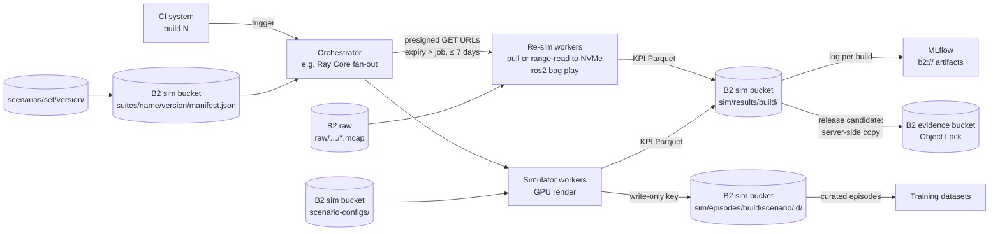
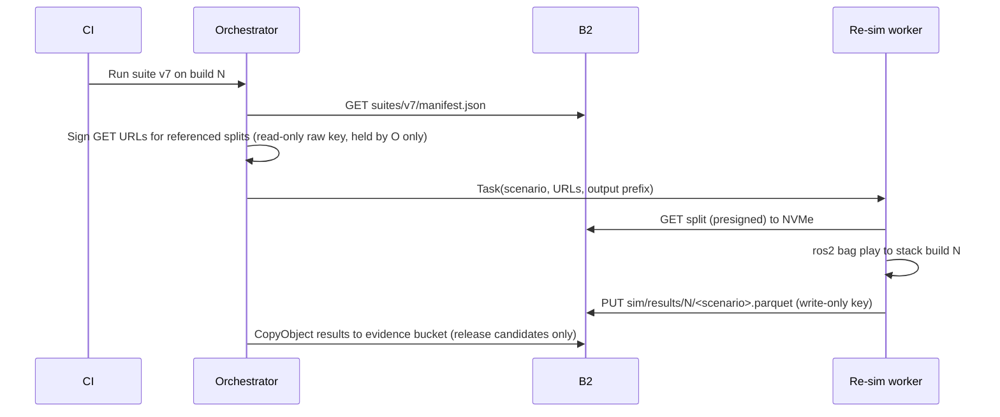

# Re-simulate real drives and synthetic scenarios against each stack build and keep comparable KPIs

## Workload

Every candidate build of the driving stack runs against a regression suite before release. The suite has two parts:

- **Log re-simulation (re-sim):** real drive splits are replayed into the new perception and planning build in open-loop or log-replay mode.
- **Synthetic simulation:** OpenSCENARIO or CARLA/ScenarioRunner scenarios render sensor data and vehicle state for closed-loop tests.

A run covers thousands of scenarios and produces terabytes of episodes. Each build's KPI tables (collisions, off-road events, lane keeping, comfort) must stay comparable across releases, and results for release candidates become safety-case evidence.

B2 holds scenario definitions, the frozen suite manifest, simulator outputs, and KPI tables. Workers get only the access they need: presigned URLs for raw splits and a write-only key for their output prefix.

## Data flow

rosbag2 does not read over HTTP, so workers download or range-read each split to local NVMe before replay. Presigned URLs expire after at most 7 days. Long-queued jobs must request fresh URLs rather than relying on URLs signed at submission time.

## B2 zones

| Zone | Bucket and prefix | Versioning and lifecycle | Object Lock | Purpose |
|---|---|---|---|---|
| Raw (input) | `<org>-av-raw/raw/` | See [drive-log offload](../drive-log-offload-ingest/architecture.md) | Optional | Real drive splits |
| Scenario configs | `<org>-av-sim/scenario-configs/<set>/<version>/` | Immutable versions | No | OpenSCENARIO or CARLA JSON |
| Suites | `<org>-av-sim/suites/<name>/<version>/manifest.json` | Immutable | No | Frozen regression suite (scenario and split references) |
| Episodes | `<org>-av-sim/sim/episodes/<build>/<scenario>/<id>/` | Hide after N days, then delete ([lifecycle-train-sim.json](../../examples/lifecycle-train-sim.json)) | No | Bulk synthetic RGB, depth, segmentation, LiDAR, and state |
| Results | `<org>-av-sim/sim/results/<build>/` | Keep | No | Per-run KPI Parquet |
| Evidence | `<org>-av-evidence/sim-results/<build>/` | Never expire while locked | Governance default | Release-candidate results for the safety case |

Episodes and results sit under different top-level paths (`sim/episodes/` and `sim/results/`) because B2 lifecycle rules match name prefixes. One rule can then expire bulk frames while KPI tables stay.

## Boundaries

| Stays off B2 | Where it lives | Why |
|---|---|---|
| Simulator GPU servers and render state | GPU nodes | Compute |
| Scenario scheduler and queue | Ray head or a queue service | Control plane |
| CI system | CI | Triggers runs, gates releases |
| MLflow tracking database | MLflow backend database | Run metadata |
| Results dashboard database | Analytics database | Interactive queries; B2 holds the Parquet source |

## B2 capability map

| Capability | Used | How |
|---|---|---|
| S3-compatible API | Yes | MLflow, the orchestrator (URL signing), and workers through an S3 SDK |
| Presigned URLs | Yes | GET URLs for raw splits so workers hold no raw key |
| CORS | No | No browser access |
| Range GETs | Yes | Partial split reads using the MCAP chunk index |
| Multipart upload | Yes | Large episode files (client-managed) |
| Scoped application keys | Yes | Orchestrator raw reader; worker writer on `sim/`; release copier |
| Event Notifications | Optional | Start the KPI roll-up when the last result lands |
| Object versions | Yes | Overwrite protection for suites and results |
| Lifecycle rules | Yes | Expire `sim/episodes/` |
| SSE-B2 | Yes | Default encryption |
| Object Lock | Yes | Evidence bucket |
| Cloud Replication | No | Not part of this flow |
| Included egress, CDN, compute partners | Yes | GPU simulation farms read B2 directly; check [pricing](https://www.backblaze.com/cloud-storage/pricing) |
| Standard B2 vs Overdrive vs local cache | Standard plus NVMe | Splits are read once per scenario. Consider [Overdrive](https://www.backblaze.com/cloud-storage/b2-overdrive) only if measured suite wall-clock time is bound by storage reads |

## Configure the integrations

Derive `https://s3.<region>.backblazeb2.com` from each bucket's region.

### Orchestrator (Ray Core or a queue)

- Ray Core (or any scheduler) only fans out tasks; it has no B2 connection of its own and no `storage_path`. Ray Train's persistent storage, described in the [training architecture](../perception-training-data-checkpoints/architecture.md#ray-train), does not apply here.
- The orchestrator holds the read-only raw key, used only to sign URLs. Workers get presigned URLs and a write-only `sim/` key, and move bytes with an S3 SDK (B2 pattern).

### MLflow

- Log one run per (build, suite version), with KPI tables and reports as artifacts in a `b2://` store or an `s3://` store with `MLFLOW_S3_ENDPOINT_URL` ([Backblaze MLflow guide](https://www.backblaze.com/docs/cloud-storage-connect-backblaze-b2-to-mlflow)).
- Tag each run with the build ID, suite version, and simulator version so results stay comparable.

### Simulator and rosbag2 workers

Workers transfer CARLA, ScenarioRunner, and rosbag2 inputs and outputs with an S3 SDK or presigned URLs. The [CARLA Sensor Data Lake](https://github.com/backblaze-b2-samples/carla-sensor-data-lake) and [Rosbag2 Cloud Offload](https://github.com/backblaze-b2-samples/rosbag2-cloud-offload) samples show this.

## Security

- Workers never hold a raw-bucket key. A leaked worker credential exposes only its presigned URLs and write access to `sim/`.
- Only the release pipeline's publisher key can write to the evidence bucket. The evidence copy is a server-side copy, so that key covers both `<org>-av-sim` and `<org>-av-evidence` with `listFiles,readFiles,writeFiles,writeFileRetentions` (plus `writeFileLegalHolds` where used). See [examples/README.md](../../examples/README.md#scoped-application-keys).
- Don't log presigned URLs. Redact query strings in worker logs.
- Store a checksum with every result file, and reference results in the evidence bucket by version ID.

## References

- [Backblaze S3-compatible API](https://www.backblaze.com/docs/cloud-storage-s3-compatible-api)
- [B2 lifecycle rules](https://www.backblaze.com/docs/cloud-storage-lifecycle-rules)
- [B2 Object Lock](https://www.backblaze.com/docs/cloud-storage-object-lock)
- [ROS 2 recording and playback](https://docs.ros.org/en/rolling/Tutorials/Beginner-CLI-Tools/Recording-And-Playing-Back-Data/Recording-And-Playing-Back-Data.html)
- [B2 pricing](https://www.backblaze.com/cloud-storage/pricing)
